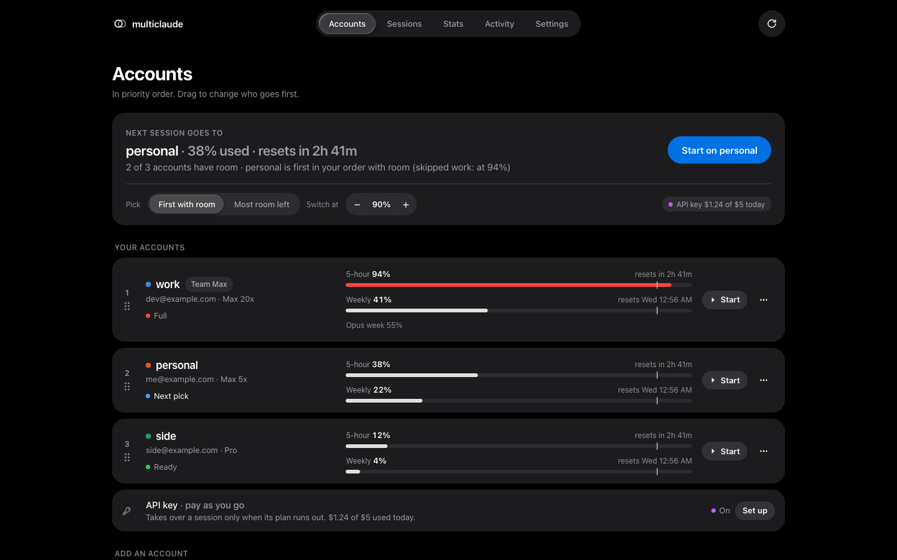
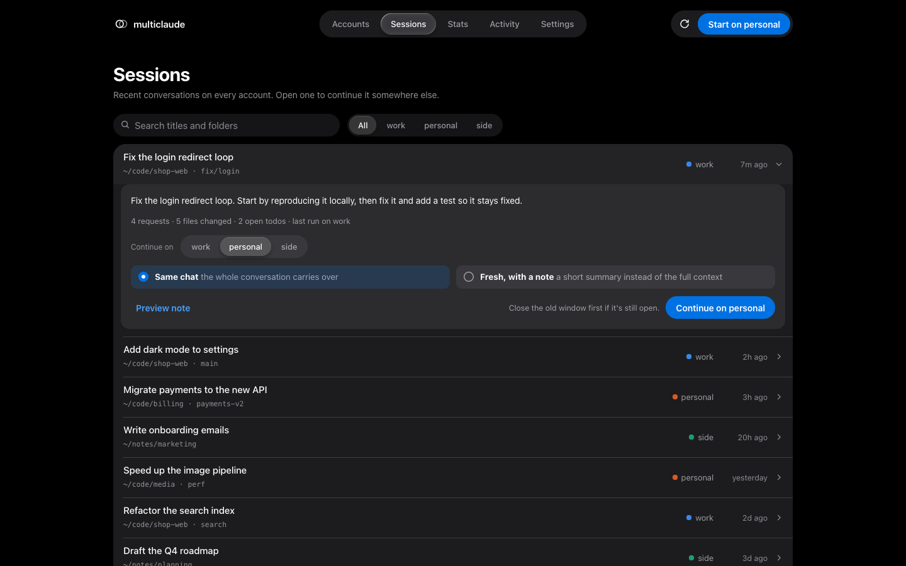
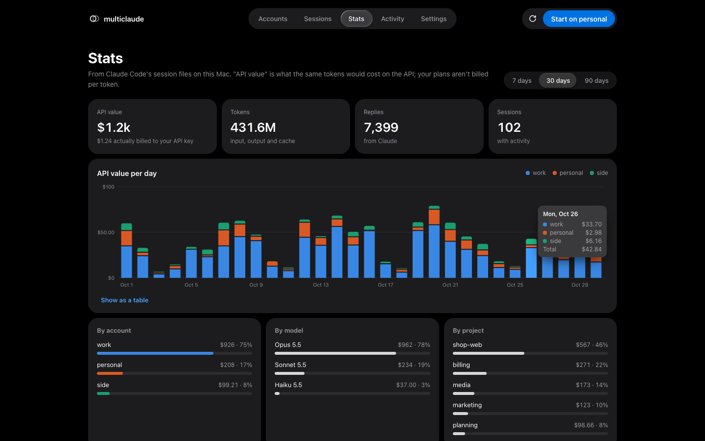
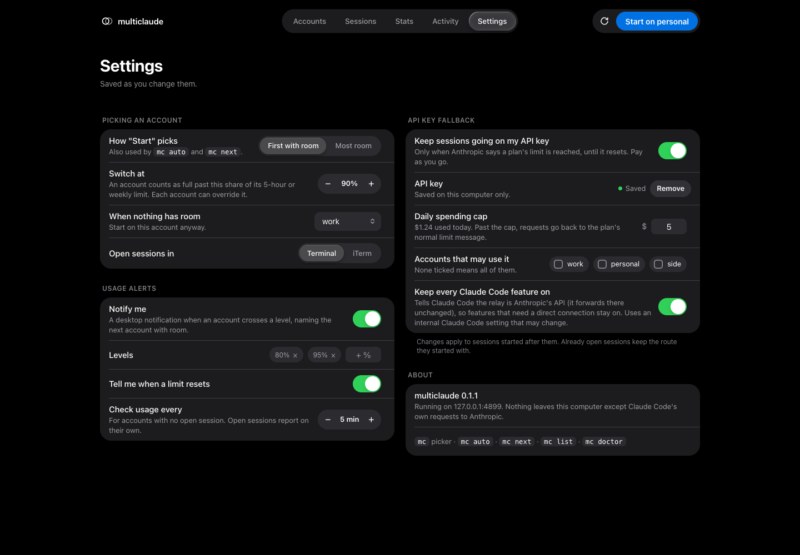
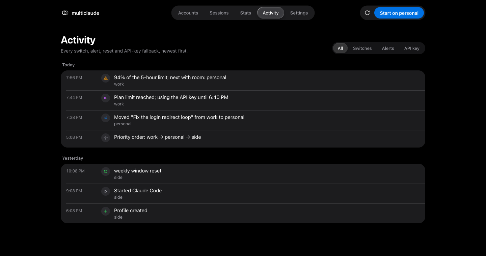
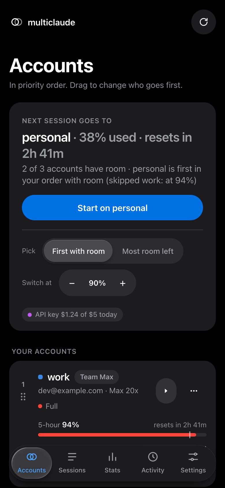

<div align="center">

# ClaudeDeck

**A local Claude Code account manager and usage dashboard for macOS, Windows, and Linux.**

Organize multiple Claude accounts, monitor usage, manage coding sessions, and choose which account to use from your terminal or local dashboard.

[Quick start](#quick-start) · [Installation](#installation) · [Windows](#windows) · [Commands](#everyday-commands) · [Documentation](#documentation)




</div>

## Overview

ClaudeDeck is a local utility for managing multiple Claude Pro or Max account profiles within Claude Code. It helps you organize accounts, monitor their usage, and select an account when starting or continuing a coding session.

Each account keeps its own login, while supported Claude Code data such as chat history, memory, settings, hooks, skills, plugins, commands, agents, and MCP servers can be shared between profiles.

The application includes a local web dashboard, terminal interface, Claude Code status-line integration, and a macOS menu bar app.

## Features

- **Multiple account profiles:** Add and manage separate Claude account profiles, each with its own login.
- **Account priority:** Arrange accounts in a preferred order and configure the usage threshold at which an account is considered full.
- **Automatic account selection on launch:** Optionally configure the `claude` command to start with the account selected by ClaudeDeck.
- **Usage monitoring:** View 5-hour and weekly usage limits, including per-model weekly limits on supported plans.
- **Multiple interfaces:** Monitor usage through the local web dashboard, terminal picker, Claude Code status line, and macOS menu bar app.
- **Usage alerts:** Receive desktop notifications when configured usage thresholds are reached and when limits reset.
- **Session continuation:** Move a session to another account with available capacity using an explicit command or the session interface.
- **Auto-resume:** Wait for the same account's usage limit to reset and continue a session when supported by the application.
- **Optional API-key fallback:** Configure your own Anthropic API key for paid API usage when a plan limit is reached. A daily spending cap can be configured.
- **Usage statistics:** Review estimated API-equivalent usage by day, account, model, and project using local Claude Code session files.
- **Encrypted export:** Export your setup in encrypted form to move it to another computer.

### Account switching and usage limits

ClaudeDeck does not silently move a running conversation between Claude subscription accounts. Moving a session to another account is an explicit user action, such as selecting **Move to** or running `mc next`.

Automatic resume waits for the same account's usage limit to reset. The optional API fallback uses your own paid Anthropic API key and incurs API charges.

Do not use account management to pool subscriptions or evade provider usage limits. You are responsible for using your accounts in accordance with Anthropic's terms.

## Screenshots

| Accounts and usage | Sessions |
|---|---|
|  |  |

| Usage statistics | Settings |
|---|---|
|  |  |

| Activity |
|---|
|  |

<p align="center">
  
</p>

The repository includes sample data for the dashboard. Run `npm run demo` to view the demo without connecting an account.

## Requirements

- **Operating system:** macOS 13+, Windows 10/11, or Linux.
- **Node.js:** 22.18+ or 23.6+.
- **Git:** Required for cloning the repository.
- **Claude Code:** Installed and signed in (`claude --version` should work).
- **Claude account:** One or more Claude Pro or Max accounts.
- **Anthropic API key:** Optional; required only if you want to use the API-key fallback.

The macOS menu bar application is available only on macOS. The local dashboard provides the corresponding usage overview on Windows and Linux.

## Installation

### macOS and Linux

Clone the repository and run setup:

```bash
git clone https://github.com/finefigo/claudedeck.git
cd claudedeck
./bin/mc setup --shell
```

The setup command can:

1. Add the `mc` command to your PATH.
2. Add a Claude Code status line and session hook to `~/.claude/settings.json`, keeping a backup of the existing settings file.
3. Configure the background service to start at login.
4. Build and configure the macOS menu bar application when supported.
5. Install the session-move integration.
6. With `--shell`, configure your shell so that the plain `claude` command uses the account selected by ClaudeDeck.

On macOS, the menu bar app requires the Xcode command line tools. Use `--no-menubar` to skip it.

After setup, open a new terminal tab and run:

```bash
mc doctor
```

### Windows

Open PowerShell with Node.js, Claude Code, and Git installed:

```powershell
git clone https://github.com/finefigo/claudedeck.git $HOME\claudedeck
node --disable-warning=ExperimentalWarning $HOME\claudedeck\src\cli.ts setup --shell
```

The setup process configures the `mc.cmd` command and starts the background service at login.

- ClaudeDeck supports account selection in PowerShell and Git Bash.
- If PowerShell reports that scripts are disabled, run this once:

  ```powershell
  Set-ExecutionPolicy -Scope CurrentUser RemoteSigned
  ```

- In plain Command Prompt (`cmd.exe`), use `mc auto`.
- Notifications use Windows toast notifications.
- Shared folders use directory junctions. Shared files use symlinks when Developer Mode is enabled and hard links otherwise.

Open a new terminal tab after setup, then check the installation:

```powershell
mc doctor
```

### Linux service

On Linux, use the same setup command as macOS:

```bash
./bin/mc setup --shell
```

The background service runs as a systemd user unit.

## Quick start

Add your Claude account profiles and arrange their priority:

```bash
mc add work --label "Team Max"
mc add personal
mc order work personal main
```

Optionally configure the usage threshold for an account:

```bash
mc set main switch-at 80
```

Start Claude Code using the first account in your configured order that has room:

```bash
claude
```

You can also use:

```bash
mc auto
```

To move the current folder's latest session to the next account with room:

```bash
mc next
```

To start a fresh session on the next account with a short handover note:

```bash
mc next --fresh
```

Open the local dashboard:

```bash
mc ui
```

The dashboard is available at `http://127.0.0.1:4880`.

## Everyday commands

| Command | Description |
|---|---|
| `mc` | Open the terminal account picker. |
| `mc auto [args]` | Start Claude Code using the first account with room. |
| `mc <name> [args]` | Start Claude Code using a specific account profile. |
| `mc next [--fresh]` | Move the latest session in the current folder to the next account with room. |
| `mc resume <name> [id]` | Resume a session on a selected account. |
| `mc list` | Show accounts, usage, priority order, and the account selected by `mc auto`. |
| `mc ui` | Open the local dashboard. |
| `mc doctor` | Check the installation and report configuration issues. |

For the full command reference and available options, see [the usage guide](docs/usage.md).

## Documentation

| Guide | Description |
|---|---|
| [Setup](docs/setup.md) | Installation, adding accounts, API key configuration, permissions, updates, and uninstalling. |
| [Usage](docs/usage.md) | Commands, terminal picker, dashboard, menu bar, status line, alerts, sessions, statistics, and export. |
| [Configuration](docs/configuration.md) | Configuration file fields, environment variables, and files created by the application. |
| [How it works](docs/how-it-works.md) | Account profiles, shared data, usage sources, account selection, API relay, statistics, and security model. |
| [Troubleshooting](docs/troubleshooting.md) | Common problems and frequently asked questions. |
| [Decisions](docs/decisions.md) | Product and design decisions. |

## Privacy and security

- The application runs locally. Its background service listens on `127.0.0.1`.
- Account logins remain in the locations used by Claude Code, such as the macOS Keychain or profile credential files on Windows and Linux.
- The application reads account credentials to request usage information. It does not refresh or copy them, except when included in an encrypted export explicitly requested by the user.
- The optional API key is stored in the macOS Keychain or in a user-readable-only file on Windows and Linux.
- Dashboard changes require a random token available to the dashboard and menu bar application.
- Network requests include Claude Code's own requests to Anthropic and periodic usage checks for accounts without an open session.

Review the configuration and security documentation before using the application with personal accounts.

## Development

Install the development dependencies:

```bash
npm install
```

Run the test suite:

```bash
npm test
```

Type-check the project:

```bash
npm run check
```

Run the lint checks:

```bash
npm run lint
```

Start the dashboard with sample data:

```bash
npm run demo
```

The demo dashboard is available at `http://127.0.0.1:4899`.

The project layout is organized as follows:

```text
claudedeck/
├── src/          # TypeScript application and CLI
├── web/          # Local dashboard (HTML, CSS, JavaScript)
├── menubar/      # macOS menu bar application (Swift)
├── test/         # Tests
├── scripts/      # Supporting scripts
├── docs/         # Guides and screenshots
├── bin/          # CLI launcher
├── package.json
└── README.md
```

## Disclaimer

ClaudeDeck is an independent, community-maintained project and is not made by, endorsed by, or affiliated with Anthropic. Claude and Claude Code are trademarks of Anthropic.

The application interacts with Claude Code settings and usage endpoints that may change in future Claude Code updates. Use the application at your own discretion and comply with [Anthropic's terms](https://www.anthropic.com/legal/consumer-terms).

## Attribution

This repository is based on the original **MultiClaude** project by [subh05sus](https://github.com/subh05sus/multiclaude). The original project and its MIT licence are retained as the basis for this repository. Please refer to the original repository for upstream changes and history.

## ClaudeDeck-specific changes

Compared with the credited upstream project, this repository's current changes focus on ClaudeDeck branding and project maintenance:

- A rewritten README with an updated overview, installation instructions, command reference, and reorganized screenshot gallery for `finefigo/claudedeck`.
- Package and plugin marketplace metadata for the ClaudeDeck repository.
- Migration support for the Move plugin's old `multiclaude` marketplace alias.
- The Unix `bin/mc` launcher is kept executable so the documented macOS and Linux setup commands can run it directly.

The account-profile, session, usage-tracking, and dashboard implementation remains largely based on MultiClaude. This section describes repository-specific maintenance; it does not claim those inherited features as new work.

## License

This project is distributed under the MIT License. See the [LICENSE](LICENSE) file for details.
